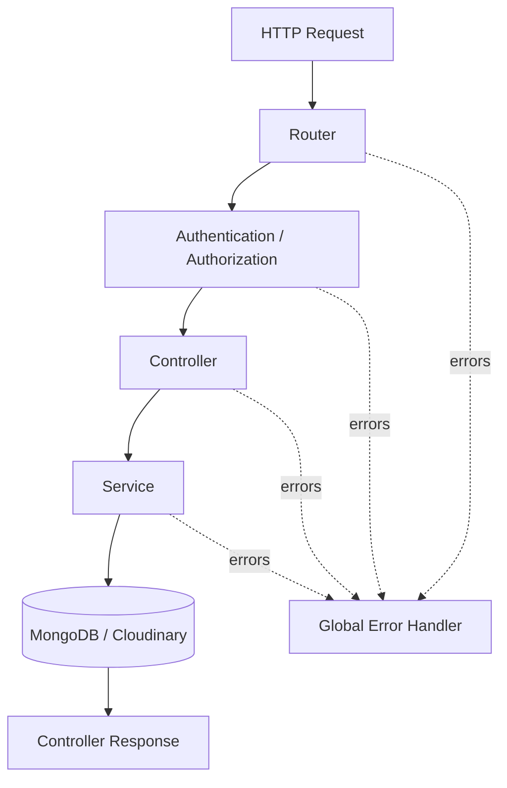

# 📚 Ebook API

A REST API for managing an ebook library. The backend is built with **Node.js, Express 5, TypeScript, MongoDB/Mongoose, JWT, Multer, and Cloudinary**.

The project currently provides user authentication and book catalogue management, including cover-image and PDF uploads.

## Features

- User registration and login with bcrypt password hashing
- JWT access tokens and refresh-token cookies
- Role-based authorization for admin-only book management
- Book creation, listing, detail retrieval, updating, and deletion
- Pagination for the public book listing
- Cover-image and PDF uploads stored in Cloudinary
- Centralized API error handling
- TypeScript strict mode

## Tech stack

| Concern | Technology |
|---|---|
| Runtime | Node.js (ES modules) |
| API | Express 5 |
| Language | TypeScript |
| Database | MongoDB with Mongoose |
| Authentication | JSON Web Tokens |
| Password hashing | bcrypt |
| Upload handling | Multer |
| Asset storage | Cloudinary |
| Development runner | tsx |

## Architecture

The backend uses a **feature-based (module-based) structure**. Each domain owns its controller, service, routes, model, and types. Shared infrastructure stays outside the feature modules.

```text
ebook/
├── src/
│   ├── modules/
│   │   ├── auth/
│   │   │   ├── auth.controller.ts
│   │   │   ├── auth.service.ts
│   │   │   └── auth.routes.ts
│   │   │
│   │   ├── users/
│   │   │   ├── user.model.ts
│   │   │   └── user.types.ts
│   │   │
│   │   └── books/
│   │       ├── book.controller.ts
│   │       ├── book.service.ts
│   │       ├── book-assets.service.ts
│   │       ├── book.model.ts
│   │       ├── book.routes.ts
│   │       └── book.types.ts
│   │
│   ├── config/
│   │   ├── cloudinary.ts
│   │   ├── config.ts
│   │   └── db.ts
│   │
│   ├── middlewares/
│   │   ├── authorizeRoles.ts
│   │   ├── globalErrorHandler.ts
│   │   ├── upload.ts
│   │   └── verifyJWT.ts
│   │
│   ├── types/
│   │   └── express.d.ts
│   │
│   └── utils/
│       └── asyncHandler.ts
│   │
│   └── app.ts
│
├── server.ts
├── .env.example
├── .gitignore
├── package.json
├── package-lock.json
├── tsconfig.json
└── README.md
```

### Request lifecycle



### Responsibilities

- **Routes:** Map HTTP methods and paths to middleware and controllers.
- **Middleware:** Handle cross-cutting concerns such as authentication, authorization, uploads, and errors.
- **Controllers:** Read request data, call services, and shape HTTP responses. Keep business logic out of controllers.
- **Services:** Implement business rules and coordinate database and Cloudinary operations.
- **Models:** Define MongoDB document structure and persistence rules.
- **Types:** Define domain and request types.
- **Config:** Initialize external infrastructure and read environment configuration.
- **Utils:** Hold small shared helpers that are not specific to one feature.

## Getting started

### Requirements

- Node.js (use a current LTS release)
- npm
- MongoDB connection string (local MongoDB or Atlas)
- Cloudinary account

### Install

```bash
git clone https://github.com/iamsyedbilal/ebook.git
cd ebook
npm install
```

### Environment variables

Create a local `.env` file in the repository root. Never commit this file.

| Variable | Purpose |
|---|---|
| `PORT` | API port (defaults to 3000 in the server entry point) |
| `NODE_ENV` | `development` or `production` |
| `MONGO_CONNECTION_STRING` | MongoDB connection URI |
| `JWT_ACCESS_TOKEN_SECRET` | Secret used to sign access tokens |
| `JWT_REFRESH_TOKEN_SECRET` | Secret used to sign refresh tokens |
| `CLOUDINARY_CLOUD_NAME` | Cloudinary cloud name |
| `CLOUDINARY_API_KEY` | Cloudinary API key |
| `CLOUDINARY_API_SECRET` | Cloudinary API secret |

Generate long, random, different values for the two JWT secrets. Do not reuse production credentials in development.

### Run locally

```bash
npm run dev
```

The API starts after a successful MongoDB connection.

### Type-check and build

```bash
npm run typecheck
npm run build
npm start
```

The production build is emitted to `dist/`.

## API overview

Base URL: `/api/v1`

### Authentication

| Method | Endpoint | Access | Description |
|---|---|---|---|
| POST | `/users/register` | Public | Create a user |
| POST | `/users/login` | Public | Log in and receive an access token + refresh cookie |
| POST | `/users/refresh-token` | Refresh cookie | Issue a new access token |
| POST | `/users/logout` | Authenticated | Clear the refresh-token cookie |

Protected routes use:

```http
Authorization: Bearer <access-token>
```

The refresh endpoint deliberately does **not** use the access-token middleware: it verifies the refresh-token cookie itself.

### Books

| Method | Endpoint | Access | Description |
|---|---|---|---|
| GET | `/books` | Public | List books; supports `page` and `limit` |
| GET | `/books/:slug` | Authenticated | Retrieve one book |
| POST | `/books` | Admin | Create a book |
| PATCH | `/books/:slug` | Admin | Partially update a book |
| DELETE | `/books/:slug` | Admin | Delete a book and its assets |

Book creation and update use `multipart/form-data`. Upload field names:

- `coverImage` — one image file
- `file` — one PDF file

Text fields for a book: `title`, `author`, `genre`, `description`, and optional `price` (defaults to `0` on creation).

## Important implementation notes

- Book controllers are intentionally thin. Put new book business rules in `src/modules/books/book.service.ts`.
- Cloudinary upload and cleanup orchestration belongs in `book-assets.service.ts`.
- PDF assets are uploaded and deleted with Cloudinary resource type `raw`; cover images use `image`.
- Book slugs are generated from titles and must be unique.
- A book stores Cloudinary `url` and `publicId` for both its cover image and PDF.
- The `createdBy` field references the user who created the book.
- Admin authorization is enforced in the book routes with `verifyJWT` followed by `isAdmin('admin')`.

## Current status and follow-up work

This README is also the project's working context. Update this section whenever a major feature or architectural decision changes.

### Implemented

- [x] Feature-based modules for authentication, users, and books
- [x] Thin book controllers and dedicated book service
- [x] Separate Cloudinary asset lifecycle service
- [x] Typed authenticated-user request context
- [x] Centralized error response handling
- [x] TypeScript build and type-check scripts
- [x] API and architecture documentation

### Known limitations / next improvements

- [ ] Add automated unit and API integration tests.
- [ ] Implement persisted refresh-token sessions, rotation, reuse detection, and server-side revocation. The current refresh endpoint only issues a new access token.
- [ ] Make logout revoke the server-side refresh session once session storage is implemented.
- [ ] Validate environment variables at startup rather than relying on type assertions.
- [ ] Validate actual uploaded file signatures; Multer MIME type alone can be spoofed.
- [ ] Add login/register rate limiting and configure CORS/security headers for the deployed frontend.
- [ ] Add request-schema validation (for example, Zod) instead of relying only on controller/service checks.
- [ ] Add reliable retry/monitoring for failed Cloudinary cleanup operations.
- [ ] Add Swagger/OpenAPI documentation and CI checks.

## Contribution and code conventions

1. Keep controllers focused on HTTP input/output.
2. Put business logic in the relevant feature service.
3. Keep database access in services or narrowly scoped repositories; do not duplicate it in controllers.
4. Validate untrusted request input before using it.
5. Use explicit TypeScript types; avoid `any`.
6. Keep secrets in environment variables and update `.env.example` when configuration changes.
7. Preserve the API contract unless a breaking change is intentional and documented.
8. Add or update tests for every behavior change.
9. Use small, descriptive commits and work on feature branches.

## Project context for future maintenance

When continuing work on this repository, read this README first. Treat the architecture and API overview above as the current intended design, then inspect the actual source before editing. The "Known limitations / next improvements" checklist records work that is not yet complete; do not assume an unchecked item has been implemented.
